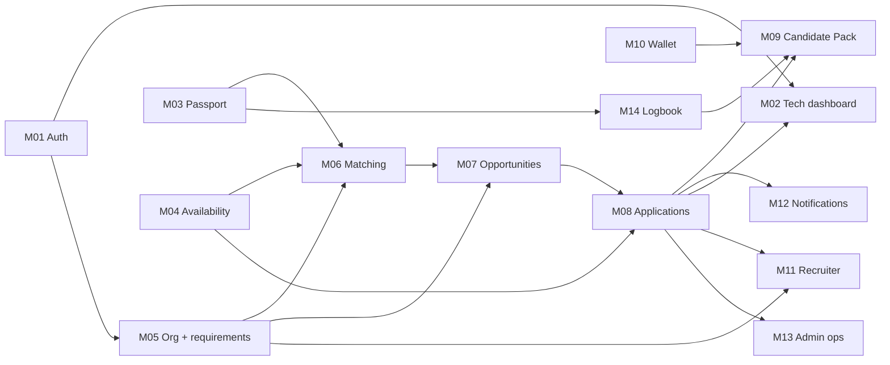

# 10 · Master parity matrix — v1.1 / v1.3 / v1.8 (demo + connected) vs Next.js + Supabase

Audited 2026-10-19 against `main` @ `0aff454` (production = release 1 `65df3b9`). Read-only audits of every
v1.8 source file (`server/*.mjs`, `src/LegacyApp.jsx`, `BetaPreview.jsx`, `beta/`, `components/v11`,
`features/`, `tools/`, `data/`, `business.js`, `domain.js`, `context/`, `storage.js`) and of v1.3, cross-checked
with the code. This file **supersedes the statuses** of `02-parity-matrix.md`, `09-v18-delta.md` and
`docs/audit/{PARITY_MATRIX,FEATURE_INVENTORY,VISUAL_PARITY}.md` where they disagree (§6 lists the stale rows).

**Sources:** v1.8 = `tmp/references/crewflex-v18/CrewFlex-v1.8` (from `tmp/CrewFlex_v1.8.zip`) · v1.3 =
`tmp/references/crewflex-v13/CrewFlex-v1.3` (`CrewFlex_v1.3_Unificada.zip`) · **v1.1: NOT AVAILABLE** (no file
`CrewFlex_v1.1*` anywhere on the machine; nothing is claimed about it).

**v1.8 runs two different products:** the **demo** (IndexedDB `crewflex-v12`, fictional world, role switcher)
and the **connected app** (`server/app.mjs`, 287 lines, Node + SQLite, invite-only accounts). Rows are tagged
`D` (demo) or `C` (connected). Unreachable legacy code is `DEAD`: `components/screens/*`, `components/company/*`,
`Header.jsx`, `Navbar.jsx`, `features/AdminDemo.jsx`, `screens/CandidatePackModal.jsx`.

**Status:** `PRESENT` equivalent or better, with tests · `PARTIAL` (gap named) · `MISSING` · `BLOCKED <decision>`
· `SCOPE <LATER|OUT>` (V1_SCOPE) · `DEMO-ONLY` · `DO-NOT-COPY` (insecure in the prototype) · `DEAD`.

## 1. Module summary

| Module                            | Prio | State                    | Present / partial / missing | Blocking                                                                    |
| --------------------------------- | ---- | ------------------------ | --------------------------- | --------------------------------------------------------------------------- |
| M00 Foundation, nav, shell        | P0   | AUDITED                  | 3 / 3 / 2                   | C-12 (dock/visual direction)                                                |
| M01 Auth and account              | P0   | VERIFIED_LOCAL (batch 1) | 5 / 3 / 2                   | OD-8 (invite-only), retention P3/M-3 (account close)                        |
| M02 Technician dashboard          | P1   | AUDITED                  | 1 / 4 / 6                   | D-06 (applications), opportunities                                          |
| M03 Professional passport         | P1   | AUDITED                  | 6 / 6 / 9                   | C-10/D-02/D-03, OD-6/D-04, OD-7, D-07/D-10 (avatar)                         |
| M04 Availability and calendar     | P0   | VERIFIED (prod)          | 9 / 4 / 3                   | D-06 (assigned days), NEXT: AOG opt-in                                      |
| M05 Organization and requirements | P0   | AUDITED                  | 2 / 9 / 12                  | R-D4 (drafts), C-9/D-08, OD-4/D-09, OD-5, OD-7, SCOPE LATER (rates)         |
| M06 Directory and matching        | P1   | VERIFIED_LOCAL (batch 2) | 7 / 4 / 4                   | D-07 (free directory), OD-7 (rate filter), C-10 (category/aircraft filters) |
| M07 Opportunities (technician)    | P1   | NOT_STARTED              | 0 / 0 / 6                   | D-06, D-07, D-12 (marketplace visibility)                                   |
| M08 Applications and hiring       | P0*  | SPECCED                  | 0 / 0 / 14                  | **D-06 Q2–Q6 ratification**                                                 |
| M09 Candidate Pack                | P1   | SPECCED                  | 0 / 0 / 7                   | **D-07 P1–P4**, D-10 scanner, SCOPE LATER                                   |
| M10 Document wallet               | P1   | VERIFIED_LOCAL           | 6 / 4 / 1                   | Release 2 approval (retention 30 d/24 h, legal hold, maintenance)           |
| M11 Recruiter                     | P2   | SPECCED                  | 0 / 1 / 7                   | D-12, SCOPE LATER                                                           |
| M12 Messaging, notifications      | P2   | NOT_STARTED              | 0 / 0 / 7                   | SCOPE OUT (chat), C-11 (channels), D-06                                     |
| M13 Administration                | P2   | AUDITED                  | 1 / 3 / 9                   | OD-3, SCOPE OUT (full back office), OD-7                                    |
| M14 Logbook                       | P2   | NOT_STARTED              | 0 / 0 / 3                   | SCOPE LATER                                                                 |
| M15 Tools                         | P1   | VERIFIED (prod)          | 5 / 1 / 5                   | D-11 (fuel: technical review), SCOPE LATER (glossary, translator)           |
| M16 Complementary (learning…)     | P2   | NOT_STARTED              | 0 / 0 / 4                   | SCOPE LATER                                                                 |
| M17 Visual parity                 | P1   | AUDITED                  | see §5                      | C-12                                                                        |

\* P0 for a complete hiring journey, but blocked until the owner ratifies the D-06 contract.

## 2. Dependency graph and order

Executable order without new decisions: **M01 (recovery) → M06 (list tools over the existing pool) → M02
(checklist + read-only calendar) → M10 (expiry states) → M04/M15 small gaps → docs/visual (M17)**. Everything
from M07 onwards waits for D-06/D-07 ratification (or a scope change for LATER items).

## 3. Inventory by module

Source refs: `C:` = `server/<file>:<line>`, `D:` = `src/<path>` (v1.8). Target refs are under the repo root.

### M00 Foundation and navigation

| ID             | Src                                                      | Behaviour                                                                                                                         | Target                           | Status                                        |
| -------------- | -------------------------------------------------------- | --------------------------------------------------------------------------------------------------------------------------------- | -------------------------------- | --------------------------------------------- |
| TD-01          | D: LegacyApp `Shell`                                     | Technician sidebar: home, passport, availability, opportunities, applications, wallet, logbook, tools, privacy, learning, account | `components/layout/AppShell.tsx` | PARTIAL: entries exist only for built modules |
| TD-02          | D: Shell dock                                            | Mobile bottom dock (5 items)                                                                                                      | NavLinks wrap                    | MISSING · C-12                                |
| TD-03          | D: Shell                                                 | Mobile menu, breadcrumb, skip link, scroll-top                                                                                    | skip link, wrapped nav           | PARTIAL: no breadcrumb                        |
| TD-04/05/08/09 | D: role select, phone preview, demo banner, DemoSwitcher | Demo role/character switching                                                                                                     | role from memberships            | DEMO-ONLY                                     |
| TD-10          | D: AppState toast/saving                                 | Toast per commit, saving state, save-failure alert, audit of last 200                                                             | `ui/Notice` with requestId       | PARTIAL: no audit view                        |
| TD-11          | —                                                        | v1.8 is Spanish only                                                                                                              | ES/EN switch, persisted          | PRESENT (better)                              |
| CX-09          | C: app.mjs:151                                           | Strict CSP, nosniff, DENY, Permissions-Policy                                                                                     | `next.config.ts` headers, no CSP | PARTIAL: CSP pending                          |

### M01 Auth and account

| ID          | Src                  | Behaviour                                                                                  | Target                                                                                                                         | Status                                                     |
| ----------- | -------------------- | ------------------------------------------------------------------------------------------ | ------------------------------------------------------------------------------------------------------------------------------ | ---------------------------------------------------------- |
| CX-01/05    | C: app.mjs:156,163   | Session read, logout                                                                       | Supabase SSR session, `signOutAction`                                                                                          | PRESENT                                                    |
| CX-02       | C: app.mjs:160       | Invite-only register, terms consent, duplicate email blocked                               | open sign-up (`signUpAction`)                                                                                                  | PARTIAL · OD-8 (invite-only), terms consent text pending   |
| CX-03       | C: app.mjs:161       | Email verification link                                                                    | Supabase confirmation (default link); `/auth/confirm` exists since batch 1 (code / token_hash) but sign-up does not use it yet | PARTIAL                                                    |
| CX-04       | C: app.mjs:162       | Login, per-email throttle, generic error, unverified 403, audit                            | `signInAction`, `EMAIL_NOT_CONFIRMED` mapped                                                                                   | PARTIAL: no login audit; throttling = Supabase Auth limits |
| CX-06       | C: app.mjs:164       | Forgot password: same answer whether the account exists, throttled, 1 h token              | `/forgot-password`, `requestPasswordResetAction` (Supabase rate limit)                                                         | VERIFIED_LOCAL (batch 1)                                   |
| CX-07       | C: app.mjs:165       | Reset password: consumes token, new hash, revokes sessions                                 | `/auth/confirm` + `/reset-password`, `updatePasswordAction` (`signOut({scope:"others"})`)                                      | VERIFIED_LOCAL (batch 1)                                   |
| CX-10       | C: app.mjs:48        | In-memory throttles                                                                        | Supabase Auth rate limits (remote config)                                                                                      | PARTIAL (documented)                                       |
| CX-43       | C: app.mjs:176       | Export own data (+ files)                                                                  | —                                                                                                                              | MISSING · not in V1_SCOPE (proposal)                       |
| CX-44       | C: app.mjs:142       | Close account (type CERRAR; blocked with active engagements)                               | FK cascades only                                                                                                               | MISSING · retention P3/M-3                                 |
| CX-47       | C: app.mjs:73,108    | Consent records (terms version, pack, contact)                                             | —                                                                                                                              | MISSING · D-07                                             |
| —           | v1.3                 | Multiple organizations per account                                                         | one org (`requireOrganizationContext`)                                                                                         | MISSING · OD-5                                             |
| DO-NOT-COPY | C: app.mjs:41-42,203 | Raw tokens in outbox readable by admins; CLI-minted admin invites; enumeration on register | Supabase Auth                                                                                                                  | —                                                          |

### M02 Technician dashboard

| ID       | Src                            | Behaviour                                                       | Target                                   | Status                                           |
| -------- | ------------------------------ | --------------------------------------------------------------- | ---------------------------------------- | ------------------------------------------------ |
| TD-12    | D: features/TechnicianHome     | Heading + tools shortcut                                        | `app/app/professional/page.tsx`          | PARTIAL                                          |
| TD-13/14 | D: ProfileIdentity             | Avatar upload (≤2 MB, crop 320 px) shown in shell/chat          | —                                        | MISSING · D-07/D-10 (avatar)                     |
| TD-15/16 | D: MedalStrip, progress.badges | Medals (experience, category, aircraft); rating badges          | —                                        | MISSING · OD-3/V18-12 (needs verified data)      |
| TD-17    | D: homeModel.completionItems   | 10-item completion                                              | `domain/professional.ts` 7 items (BR-11) | PARTIAL (by design, R-D5)                        |
| TD-18    | D: status modal                | Checklist ✓/○ with «Completar» deep link per item               | first missing item only                  | PARTIAL → **batch 3**                            |
| TD-19    | D: stats                       | Compatible opportunities, confirmed assignments                 | passport %, quals, windows               | PARTIAL · D-06                                   |
| TD-20    | D: mini calendar               | Month nav, day states, legend, today                            | —                                        | MISSING → **batch 3** (read-only, own windows)   |
| TD-21/22 | D: opportunityDays, feed       | Opportunity dots, top-5 compatible jobs                         | —                                        | MISSING · M07/D-06                               |
| TD-23    | D: my applications             | Top-5 applications                                              | —                                        | MISSING · D-06                                   |
| CX-51/52 | D: beta/connectedModel         | 10-item readiness; assigned/partial days; shift recommendations | completeness, `calendar.ts`              | PARTIAL · D-06 (assigned), C-9 (recommendations) |

### M03 Professional passport

| ID               | Src                              | Behaviour                                                           | Target                                                         | Status                                             |
| ---------------- | -------------------------------- | ------------------------------------------------------------------- | -------------------------------------------------------------- | -------------------------------------------------- |
| TD-25/26/27      | D: Professional2 steps, useDraft | 5-step wizard; 350 ms autosaved draft; «start empty»                | single `ProfileForm` + optimistic concurrency                  | PARTIAL: no draft/wizard (UX choice, propose)      |
| TD-28            | D: step 0                        | Name, email, phone, base (airport list), current employer           | name, free-text base                                           | PARTIAL: phone, employer · OD-6/D-07               |
| TD-29            | D: categories (12)               | B1.1–B1.4, B2, B3, Cat A/C, Mecánico, Sheet Metal, NDT, Helper      | catalog B1.1, B1.3, B2, CAT-A, CAT-C, NDT-UT2                  | PARTIAL · C-10/D-03 (catalog additions)            |
| TD-30/31         | D: aircraft, ratings             | Aircraft experience; rating per aircraft×category with restrictions | TR-* qualifications, no restrictions                           | PARTIAL · C-10/D-02                                |
| TD-32 / CX-16    | D/C                              | Years 0–60                                                          | `yearsExperience`                                              | PRESENT                                            |
| TD-33            | D: english                       | A1–C2                                                               | —                                                              | MISSING · C-10 (soft criteria)                     |
| TD-34            | D: engines                       | 7 engines (hard check)                                              | —                                                              | MISSING · C-10/D-03                                |
| TD-35            | D: skills (9)                    | Skills                                                              | SKILL BORESCOPE only                                           | PARTIAL · C-10                                     |
| TD-36 / CX-17    | D/C                              | Courses HF/EWIS/FTS/SMS with expiry + evidence                      | TRAINING quals with `requires_expiry`; evidence link in wallet | PRESENT                                            |
| TD-37 / CX-16    | D/C                              | Minimum rate €/h or €/day                                           | —                                                              | SCOPE LATER · OD-7                                 |
| TD-38            | D: mobilization hours            | 0–168 h, hard for urgent/AOG                                        | —                                                              | MISSING · NEXT (AOG opt-in)                        |
| TD-39            | D                                | Accepts travel                                                      | mobility enum                                                  | PRESENT (richer)                                   |
| TD-40            | D                                | Own tools                                                           | —                                                              | MISSING · C-10                                     |
| TD-41            | D/C                              | Work-permit countries                                               | —                                                              | MISSING · OD-6/D-04                                |
| TD-43            | D: validateProfile               | Validation rules                                                    | zod `lib/validation/professional.ts`                           | PARTIAL (fields absent)                            |
| TD-44            | D                                | Docs/courses due within 60 days                                     | —                                                              | MISSING → candidate (M10 expiry states)            |
| TD-45 / CX-13    | D/C                              | Verification labels / admin review                                  | pending/verified/rejected/expired, review queue (OD-3)         | PRESENT (stronger)                                 |
| TD-53            | D: Privacy                       | 4 visibility modes incl. verified-companies                         | 3 modes                                                        | PARTIAL · OD-5 (verified orgs)                     |
| TD-54 / CX-45/46 | D/C                              | Block employer; urgent/AOG opt-in; quiet hours                      | —                                                              | MISSING · NEXT (AOG opt-in), D-07 (blocking scope) |

### M04 Availability and calendar (release 1 in production)

| ID               | Src                                 | Behaviour                                                                | Target                                                  | Status                                    |
| ---------------- | ----------------------------------- | ------------------------------------------------------------------------ | ------------------------------------------------------- | ----------------------------------------- |
| CX-19 / TD-55    | C/D                                 | Month calendar, day states, splits/merges, version check                 | PUT per day, `replace_availability_days`, lock          | PRESENT (prod)                            |
| TD-58/60/61/63   | D: planning, Planner                | 14 rotations, custom ≤31, publish rest, preview + replace, saved pattern | `rotation.ts`, `CyclePlanner`, `availability_rotations` | PRESENT (prod)                            |
| TD-59            | D: custom editor                    | «Use 7–3 / 7–4 as base»                                                  | length + toggles                                        | PARTIAL → **batch 4** candidate           |
| TD-62            | D: «Deshacer generación» after save | Undo after save                                                          | undo of unsaved draft + discard                         | PARTIAL (by design: atomic save; propose) |
| TD-65            | D: availableOn                      | AOG day counts only for AOG jobs **and** opt-in                          | `effectiveStatus` (no opt-in)                           | PARTIAL · NEXT (AOG opt-in)               |
| TD-56/64 / CX-18 | D/C                                 | Assigned days protected; restore on cancel                               | —                                                       | MISSING · D-06                            |
| TD-57            | —                                   | Hourly windows (not in demo; connected `partial`)                        | datetime windows, BR-4.6                                | PRESENT                                   |
| TD-66 / CX-24    | D/C                                 | AOG outreach audience, deadlines, internal notices                       | —                                                       | MISSING · NEXT/C-11                       |
| V18-19           | D: CSS                              | Hatched partial-day style                                                | `mixed` state, plain style                              | PARTIAL (visual)                          |

### M05 Organization and requirements

| ID                    | Src              | Behaviour                                                                                                           | Target                                                        | Status                                                           |
| --------------------- | ---------------- | ------------------------------------------------------------------------------------------------------------------- | ------------------------------------------------------------- | ---------------------------------------------------------------- |
| CO-02                 | D: v11/Dashboard | 4 metrics, top-3 jobs coverage, quick links                                                                         | focus capacity + 5 requirements                               | PARTIAL · D-06 (applications metrics)                            |
| CO-03/CX-20           | D/C              | Org profile: name, ops email, VAT, address, country; review                                                         | name read-only                                                | MISSING · OD-5 (KYB, settings) — demo self-verify is DO-NOT-COPY |
| CO-04                 | D                | Add another org                                                                                                     | one org at sign-up                                            | MISSING · OD-5                                                   |
| CO-05                 | D                | Org activity (last 15 audit rows)                                                                                   | `audit_events` RLS, no UI                                     | PARTIAL → candidate (read-only view)                             |
| CO-08                 | —                | Workforce list                                                                                                      | `/organization/workforce`                                     | PRESENT (target-only); invites · OD-4/D-09                       |
| CO-10..13 / CX-21     | D/C              | Builder: category, min years, engines, skills, per-day selection, split/min days/consecutive, arrival, mobilization | title, location, start/end, shift, headcount, hard/soft quals | PARTIAL · C-9/D-08, C-10                                         |
| CO-14                 | D                | Rates, conditions, logistics                                                                                        | —                                                             | SCOPE LATER · OD-7                                               |
| CO-15 / CX-25         | D/C              | Urgency derived from lead time (AOG ≤10 d)                                                                          | manual urgency                                                | DO-NOT-COPY (owner C-8/D-05: AOG is declared, never inferred)    |
| CO-16 / CX-33 / CO-64 | D/C              | Fee preview, commissions, invoices                                                                                  | —                                                             | SCOPE OUT                                                        |
| CO-17/18              | D                | Live pool count while editing; preview modal                                                                        | —                                                             | MISSING → candidate (preview needs no decision)                  |
| CO-19                 | D                | Drafts / autosave                                                                                                   | `draft` enum unused                                           | BLOCKED R-D4                                                     |
| CO-21 / CX-22 / CO-23 | D/C              | Edit (blocked with active applications); pause/reopen/close (closed terminal); archive                              | GET/POST only                                                 | MISSING · needs a requirement state rule (propose with D-06)     |
| CO-22                 | D                | Coverage bar, per-day grid, effective status covered/expired                                                        | capacity overview                                             | PARTIAL · D-06 (confirmed coverage)                              |
| CO-24                 | D                | Duplicate as draft +45 d                                                                                            | —                                                             | BLOCKED R-D4                                                     |
| CO-27 / CX-23         | D/C              | Network jobs visible to all                                                                                         | org-only RLS                                                  | BLOCKED D-06/D-07 (marketplace)                                  |

### M06 Directory and matching

| ID               | Src | Behaviour                                                                              | Target                                                                                                    | Status                                                                                                  |
| ---------------- | --- | -------------------------------------------------------------------------------------- | --------------------------------------------------------------------------------------------------------- | ------------------------------------------------------------------------------------------------------- |
| CO-38/39 / CX-26 | D/C | Eligibility explanation; verified evidence                                             | `domain/matching.ts`, explain                                                                             | PRESENT (stricter)                                                                                      |
| CO-43            | —   | Internal vs external pools                                                             | capacity vs matching                                                                                      | PRESENT (target-only)                                                                                   |
| CO-30            | D   | Job context selector                                                                   | per-requirement matches                                                                                   | PARTIAL                                                                                                 |
| CO-31/32 / CX-28 | D/C | Search; filters (category, aircraft, base, English, rate, dates, eligible-only), clear | search (ref, visible name, base; accent-insensitive) + eligible-only + clear, `features/matching/list.ts` | VERIFIED_LOCAL (batch 2) for the fields the pool has; category/aircraft/English/rate/dates · C-10, OD-7 |
| CO-33            | D   | Sort relevance / rate / years                                                          | relevance (engine order) and experience                                                                   | VERIFIED_LOCAL (batch 2); rate · OD-7                                                                   |
| CO-34            | D   | 20 per page                                                                            | 20 per page over the evaluated pool (100 cap + note kept)                                                 | VERIFIED_LOCAL (batch 2)                                                                                |
| CO-35            | D   | Compact/expanded view (persisted)                                                      | —                                                                                                         | MISSING (skipped: cards already compact; add on request)                                                |
| CO-36            | D/C | Compare up to 3                                                                        | `CompareTable` (verdict, base, years, each required qualification, availability, soft score)              | VERIFIED_LOCAL (batch 2)                                                                                |
| CO-37            | D   | Profile detail modal                                                                   | MatchCard                                                                                                 | PARTIAL                                                                                                 |
| CO-41 / CX-27/34 | D/C | Anonymity tiers, contact unlock                                                        | pseudonym ref, name if open                                                                               | PARTIAL · D-07, OD-5                                                                                    |
| CO-42 / CX-45    | D/C | Employer blocking                                                                      | —                                                                                                         | MISSING · D-07                                                                                          |
| CO-44            | D   | Medals                                                                                 | —                                                                                                         | MISSING · OD-3                                                                                          |

### M07 Opportunities (technician)

TD-67 list/filters/deep link · TD-68 cards with affinity and eligibility banner · TD-69 detail · TD-70 hard
checks (category, rating, engine, courses, years, permit, mobilization, tools) · TD-71 apply modal (days,
docs, logbook, consents) · CX-23/29 published jobs, one active application — all **MISSING · D-06, D-07**.
The urgency derivation in TD-70 is DO-NOT-COPY (C-8/D-05).

### M08 Applications and hiring

CX-29 apply · CX-30 / TD-72/73 / CO-50..59 state machine, actors, reasons, timeline · CX-31 / CO-52 proposal
snapshot + explicit acceptance (R-08 decided) · CX-32 / CO-54 confirm gates (re-checked server-side, per-day
capacity, no overlap) · CO-56/57 cancel/finish · TD-64 / CX-18 assigned days — all **MISSING ·
`docs/product/APPLICATIONS_STATE_MACHINE.md`, Q2–Q6 owner proposals not ratified**. CO-53 «simulate
acceptance» = DEMO-ONLY. CX-33 commissions/invoices = SCOPE OUT.

### M09 Candidate Pack and privacy

CO-60 / TD-74 / CX-39 pack snapshot, protected identity/docs, unlock after acceptance + consent · CO-61 export
JSON / print · RC-05 present to client — **MISSING · D-07 P1–P4, D-10 scanner, SCOPE LATER**. Prototype
DO-NOT-COPY: pack copied into the application row and kept after withdrawal (C: app.mjs:110).

### M10 Document wallet (local, release 2)

| ID            | Src               | Behaviour                                          | Target                                        | Status                           |
| ------------- | ----------------- | -------------------------------------------------- | --------------------------------------------- | -------------------------------- |
| CX-38 / TD-48 | C/D               | Upload ≤5 MB (demo 2 MB), magic bytes, sha256      | `professional-documents` POST, private bucket | PRESENT (better; no WebP)        |
| CX-41 / TD-50 | C/D               | List without file id; edit title/expiry            | API select, inline edit                       | PRESENT                          |
| CX-40         | C                 | Delete (blocked if shared)                         | delete + tombstones + maintenance             | PRESENT (no sharing)             |
| TD-47         | D                 | 4 blocks as tabs (licences, CV, courses, permits)  | kinds license/course/other                    | PARTIAL                          |
| TD-49 / TD-44 | D: documentStatus | Valid / expires soon (≤45 d) / expired / no expiry | «expired» chip                                | PARTIAL → **batch 4**            |
| TD-51         | D                 | Trash and restore                                  | hard delete                                   | PARTIAL · retention not approved |
| TD-52         | D                 | In-app preview                                     | open via 60 s signed URL                      | PARTIAL                          |
| CX-14         | C: scanner.mjs    | ClamAV scan by admin                               | `scan_status` only                            | MISSING · D-10 scanner           |
| CX-39         | C                 | Third-party download with consents                 | owner only                                    | BLOCKED D-07/D-10                |

### M11 Recruiter · M12 Messaging/notifications · M13 Admin · M14 Logbook · M16 Complementary

| ID                          | Behaviour                                                                        | Status                                     |
| --------------------------- | -------------------------------------------------------------------------------- | ------------------------------------------ |
| RC-01                       | Agency org type                                                                  | PARTIAL (`staffing_agency` at sign-up)     |
| RC-02/03/04/06/08           | Client portfolio, publish per client, confirm for client, pipeline, client field | MISSING · D-12, SCOPE LATER                |
| CX-35/36 / CO-62 / TD-75    | Per-application chat, unread                                                     | SCOPE OUT (chat)                           |
| CX-37 / CO-63 / TD-06/07    | Notifications list, mark read, auto on transitions                               | MISSING · D-06, C-11                       |
| AD-01 / AD-11               | `admin/admin` credential; raw tokens in outbox                                   | DO-NOT-COPY (target uses `platform_role`)  |
| AD-12 / CX-13               | Org/profile review                                                               | PARTIAL (qualifications only) · OD-3, OD-5 |
| AD-13 / CX-14               | Document review + scan                                                           | PARTIAL · D-10                             |
| AD-14 / CX-50               | Audit view                                                                       | PARTIAL (`audit_events`, no UI)            |
| AD-03..10, AD-15 / CX-12/15 | KPIs, demand, plans, companies, offers, commissions, ops panel                   | SCOPE OUT (full back office, OD-7)         |
| TD-76/77 / CX-42            | Logbook entries, archive, CV-relevant                                            | SCOPE LATER                                |
| TD-86/87                    | Daily learning, streaks                                                          | SCOPE LATER                                |
| TD-88/89, CO-06             | Backup/import/reset                                                              | DEMO-ONLY                                  |

### M15 Tools (release 1 in production)

| ID          | Behaviour                                                                                            | Target                                       | Status                                     |
| ----------- | ---------------------------------------------------------------------------------------------------- | -------------------------------------------- | ------------------------------------------ |
| TD-78       | Home, favourites, offline badge, 7 tiles                                                             | `ToolsHome` 3 tiles, favourites              | PARTIAL: offline badge → batch 4 candidate |
| TD-79/80/81 | Converter (22 quantities, fractions, gauge/absolute, tolerance, equivalents, copy), torque, duration | `engine.ts`, `UnitConverter`, `DurationTool` | PRESENT (prod)                             |
| TD-82/83    | Fuel sheet and fuel tools                                                                            | —                                            | BLOCKED D-11 (technical review)            |
| TD-84/85    | Glossary/ATA/flashcards; translator                                                                  | —                                            | SCOPE LATER                                |

## 4. Demo fixtures (for future local QA; never production)

v1.8 seed: technician `tech-me` CF-001 «Marcos B.» (B1.1/Cat A/Sheet Metal; A320, B737NG, ATR72; 8 y; AOG days
+4, +48; blocks his employer), CF-002…CF-004; orgs AeroLine MRO (`org-1`), AeroTalent Partners (recruiter) with
client «MRO del cliente», «Empresa actual del técnico»; jobs `job-1` A320 line (+45..+51, planned),
`job-2` AOG engine change (+3..+5), `job-3` Sheet Metal ATR72 LIS (+20..+22, urgent); 3 logbook entries.
Populated world: 15 orgs, 108 technicians (variants: anonymous, private, restrictions, expired), 60 jobs, up to
3 applications per job across all states. The target's own fixtures are `supabase/seed.sql` (Alpha…Juliett,
two orgs, platform admin) and `fixtures/domain.ts`. Demo personas will be mapped when demo users are prepared
(after this phase; separate authorization).

## 5. Visual parity (M17)

Tokens and the shell were aligned in earlier batches (`docs/audit/VISUAL_PARITY.md`, partly stale — §6). Open:
mobile dock (C-12), breadcrumb, hatched partial days, teal tools identity (kept from v1.8 `tools`), medal/avatar
surfaces (blocked). A side-by-side capture pass per module (1440/1024/768/390/360) runs with each batch.

## 6. Stale statuses corrected by this audit

`02-parity-matrix.md`: P08 documents (now PARTIAL local), P19 (undo + saved pattern exist), X12 (idempotency
exists), C20 (pool cap fixed), X08 (nav wraps), X02 (BR-1.4 enforced in DB), X03/X04 (incomplete lists), «done
locally» rows now in production. `09-v18-delta.md`: V18-39 tools, V18-13 bucket, V18-14/16/17/18/19 (AOG,
draft, lock, undo, mixed state), V18-29 (document ↔ qualification link). `docs/audit/PARITY_MATRIX.md` and
`FEATURE_INVENTORY.md`: CF-C05/C06/D01–D05/I02/B01–B03/A08. `V1_SCOPE.md` lines 22–33 (deployment state).
v1.3 features no matrix listed: password forgot/reset, data export, account close UI, requirement
draft/duplicate/archive/edit/preview, offer expiry, proposal cancellation with calendar restore, document
trash/preview, logbook archive, offline service worker, multiple orgs per account, admin console, org/profile/
document review, work permit/current employer — all now rows above.

## 7. Batches

| Batch   | Module                | Content                                                                                                                                                                            | Decision needed                                                  |
| ------- | --------------------- | ---------------------------------------------------------------------------------------------------------------------------------------------------------------------------------- | ---------------------------------------------------------------- |
| **1 ✓** | M01                   | Password recovery (request + reset) and the email-link confirm route — VERIFIED_LOCAL 2026-10-19 (`scripts/local/password-reset-check.mjs` 18/18)                                  | none; production Auth redirect URL is an owner action at publish |
| **2 ✓** | M06                   | Matches list: eligible-only filter, search, sort, 20-per-page, compare up to 3 — VERIFIED_LOCAL 2026-10-19 (`list.test.ts` 7, `ui-smoke.mjs` 11h–11k, 82/82 on a production build) | none                                                             |
| 3       | M02                   | Status checklist with deep links; read-only month calendar of own availability                                                                                                     | none                                                             |
| 4       | M10/M04/M15           | Document expiry states; «use 7–3/7–4 as base»; tools offline badge                                                                                                                 | none                                                             |
| —       | M07–M09, M11–M14, M16 | see blocking column                                                                                                                                                                | D-06, D-07, D-10, D-12, OD-3/5/7, scope                          |
