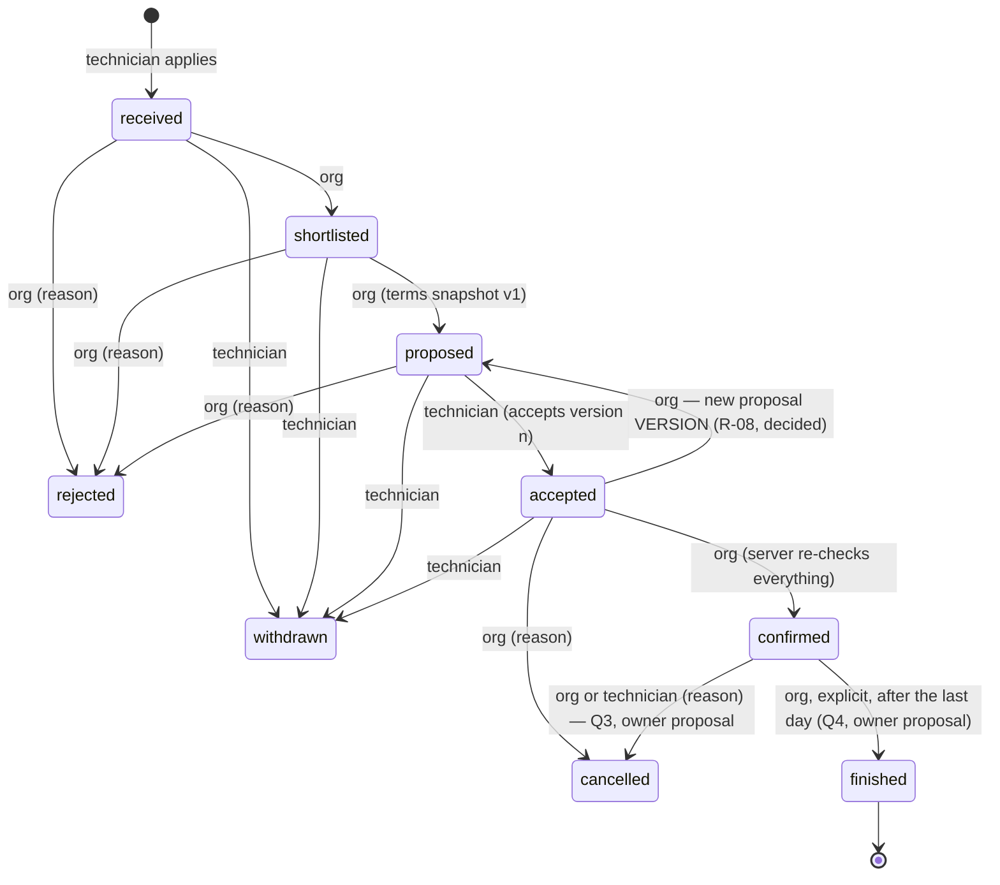

# Applications — state contract (D-06) · DRAFT FOR OWNER REVIEW

> Status: **RATIFIED 2026-10-22 for local implementation** (Q2–Q6 as proposed, **Q7: no `accepted → rejected`**; §4). Owner direction of 2026-10-19 (D-06): a server-controlled,
> transactional, authorised and audited state machine; the contract and every transition that creates
> a real commitment between organization and technician are reviewed by the owner **before** any code.
> Sources: V1.8 `server/app.mjs` `application.transition` (lines 112–125), V1.3 demo, conflict R-08
> (`docs/integration/crewflex-v13/03-business-rule-conflicts.md`). Depends on D-07 for what the
> organization may see (`CANDIDATE_PACK.md` §design).

## 1. States

| State         | Meaning (product)                                                                          | V1.8 name / ES label          |
| ------------- | ------------------------------------------------------------------------------------------ | ----------------------------- |
| `received`    | The technician applied to an open requirement with a chosen set of days                    | received · Recibida           |
| `shortlisted` | The organization is reviewing it seriously (preselection)                                  | shortlisted · Preseleccionada |
| `proposed`    | The organization sent a proposal: an immutable snapshot of the terms the requirement shows | proposed · Propuesta          |
| `accepted`    | The technician accepted **that** proposal version                                          | accepted · Aceptada           |
| `confirmed`   | The organization confirmed after the server re-checked eligibility → an **assignment**     | confirmed · Confirmada        |
| `finished`    | The assignment ended (closure)                                                             | finished · Finalizada         |
| `rejected`    | Closed by the organization before confirmation (reason required)                           | rejected · Rechazada          |
| `withdrawn`   | Closed by the technician before confirmation                                               | withdrawn · Retirada          |
| `cancelled`   | An accepted or confirmed engagement was called off (reason required)                       | cancelled · Cancelada         |

Terminal: `finished`, `rejected`, `withdrawn`, `cancelled`. No state is ever deleted; history is kept.

## 2. Transitions

| From → to                      | Actor (from the JWT, never the body)                  | Server preconditions                                                                                                                                                                                                                                                                                                                                                                                   | Writes (one transaction)                                                                 | Audit event               |
| ------------------------------ | ----------------------------------------------------- | ------------------------------------------------------------------------------------------------------------------------------------------------------------------------------------------------------------------------------------------------------------------------------------------------------------------------------------------------------------------------------------------------------ | ---------------------------------------------------------------------------------------- | ------------------------- |
| ∅ → received                   | technician (own profile)                              | requirement `open`, days in the future, no **active** application for the same requirement and no `rejected` one (Q5, owner proposal: a new application is allowed only after `withdrawn`), D-07 consents as chosen                                                                                                                                                                                    | application row, chosen days                                                             | `application.received`    |
| received → shortlisted         | org admin/manager of the requirement's org            | requirement still `open`                                                                                                                                                                                                                                                                                                                                                                               | status                                                                                   | `application.shortlisted` |
| shortlisted → proposed         | org admin/manager                                     | requirement `open`; days still future                                                                                                                                                                                                                                                                                                                                                                  | **proposal version n**: frozen copy of title, base, period, days, shift, published terms | `application.proposed`    |
| proposed → accepted            | technician                                            | explicit `acceptTerms = true` **and** the proposal version id the technician saw (stale version → 409)                                                                                                                                                                                                                                                                                                 | `accepted_version`, `accepted_at`                                                        | `application.accepted`    |
| accepted → confirmed           | org admin/manager                                     | **all re-checked at commit:** requirement open and not started; every hard qualification active + verified + valid (BR-2/3, OD-3: pending never counts); availability covers 100 % with BR-4.8 for the requirement's urgency; no overlapping confirmed assignment of the technician; confirmed count < headcount (row lock on the requirement); D-07 document conditions if the requirement needs them | status, `assignment` (derived), requirement → `covered` when headcount reached           | `application.confirmed`   |
| confirmed → finished           | org admin/manager (explicit, Q4)                      | last day has ended                                                                                                                                                                                                                                                                                                                                                                                     | status                                                                                   | `application.finished`    |
| * → rejected                   | org admin/manager                                     | from received/shortlisted/proposed only; **never from `accepted` (Q7, owner 2026-10-22: use `cancelled` with a reason, or a new proposal version)**; reason 1–1000 chars                                                                                                                                                                                                                               | status, reason                                                                           | `application.rejected`    |
| * → withdrawn                  | technician                                            | before `confirmed`                                                                                                                                                                                                                                                                                                                                                                                     | status; D-07 access ends for the future                                                  | `application.withdrawn`   |
| accepted/confirmed → cancelled | org admin/manager; technician for `confirmed` (Q2/Q3) | reason 1–1000 chars                                                                                                                                                                                                                                                                                                                                                                                    | status, reason; assignment released                                                      | `application.cancelled`   |

Every transition: one SQL function (`SECURITY INVOKER` where RLS suffices), `Idempotency-Key`
(replay returns the same result), optimistic version check (`updated_at`), `SELECT … FOR UPDATE` on the
application and, for confirmation, on the requirement (headcount race, like E-3/review race checks).
Invalid transition → 409; wrong actor → 403/404 without revealing existence; audit row in the same
transaction. Business logic in `src/domain/applications.ts` (pure table of allowed transitions, shared
with the Edge Function and mirrored by the SQL function, with a parity test as in suite M/P).

## 3. What a transition does NOT do

- **No contractual effect is invented.** Crew Flex records an intention and its terms snapshot; the
  employment or service contract is agreed directly between the parties (V1.8 notice text). Acceptance
  is not a signature; confirmation is not an employment contract.
- **No automatic notifications** (e-mail, SMS, push, WhatsApp are OUT). The other party sees the new
  state in the app. An in-app notification centre is a separate, later decision.
- **No money:** no commission, fee or invoice (OD-7, OUT). The prototype's fee fields are not ported.
- **No identity or document unlock by itself**: governed only by D-07 consents.

## 4. Decisions

R-08 is **decided**. Q2–Q6 were owner proposals of 2026-10-19 and were **ratified on 2026-10-22** for local
implementation, together with **Q7 = no `accepted → rejected`** (`08-product-decisions.md` §2026-10-22). Technical
defaults for what Q5 and the contract leave open: T-08…T-14 there. The
original questions, options and recommendations are kept for the record.

| #    | Question                                                                                | Options                                          | Recommendation (earlier)                                                                             | Status 2026-10-19                                                                                                                                                                                                                                                                                          |
| ---- | --------------------------------------------------------------------------------------- | ------------------------------------------------ | ---------------------------------------------------------------------------------------------------- | ---------------------------------------------------------------------------------------------------------------------------------------------------------------------------------------------------------------------------------------------------------------------------------------------------------- |
| R-08 | Re-proposal after acceptance                                                            | —                                                | —                                                                                                    | **DECIDED.** A new proposal creates a **new version**; it never silently changes a proposal already accepted. The new terms need an **explicit acceptance**; commitments previously accepted are **not modified retroactively** (version n stays in history as accepted; version n+1 starts as `proposed`) |
| Q2   | May the organization cancel an `accepted` (not yet confirmed) application?              | yes with reason (V1.8) · only reject             | Yes with reason, audited (it is a commitment-free state)                                             | **Ratified 2026-10-22:** the organization may cancel with a mandatory reason **before confirmation**; audited                                                                                                                                                                                              |
| Q3   | Who may cancel a **confirmed** assignment?                                              | org only (V1.8) · both parties with reason       | Both, with a mandatory reason; the technician's cancellation is visible to the org; no penalty logic | **Ratified 2026-10-22:** both parties, mandatory reason, audited; **no automatic penalties**                                                                                                                                                                                                               |
| Q4   | Does `finished` need an explicit org action or happen automatically after the last day? | explicit · scheduled job                         | Explicit org action (no scheduler needed; a pending list after the end date)                         | **Ratified 2026-10-22:** explicit closure by the organization                                                                                                                                                                                                                                              |
| Q5   | Can a technician apply to the same requirement again after `withdrawn`/`rejected`?      | never · after rejection no, after withdrawal yes | Only after `withdrawn`, as a new application (history preserved)                                     | **Ratified 2026-10-22:** a new application after `withdrawn`, never after `rejected`                                                                                                                                                                                                                       |
| Q6   | Partial staffing (several technicians covering different days of one requirement)       | later (C-4, D-08)                                | Keep one period per application in this block; per-day staffing waits for D-08                       | **Ratified 2026-10-22:** partial coverage later; one period per application in this block                                                                                                                                                                                                                  |
| Q7   | May the organization reject an `accepted` application?                                  | reject · only cancel / re-propose                | —                                                                                                    | **Decided 2026-10-22: no.** Cancel with reason (Q2) or a new proposal version (R-08); `rejected` never hides a cancellation                                                                                                                                                                                |

### 4.1 Sensitive operations (ratified 2026-10-22; D-07 items still gated)

These transitions create, change or end a real commitment between organization and technician, or
touch personal data; none is implemented until the owner ratifies its row above **and** the D-07
items it depends on (`CANDIDATE_PACK.md` §4.1):

- `proposed → accepted` and the proposal versioning (R-08 is decided; its implementation follows the
  ratified contract as a whole).
- `accepted → confirmed` (assignment) and its server re-checks.
- `accepted → cancelled` by the organization (Q2) and `confirmed → cancelled` by either party (Q3),
  including who sees the reason and how long it is kept.
- `confirmed → finished` (Q4) and the pending-closure list.
- The re-application rule (Q5), because it changes the uniqueness constraint.
- Anything that unlocks identity, contact or documents (D-07, separate consents).

Not sensitive and not blocked by ratification: the pure transition table in `src/domain` with its
tests, and documentation. **Done 2026-10-20:** `src/domain/applications.ts` (BR-13; rows depending on
Q2–Q4 carry `pending`), 6 tests — still used by nothing. No migration, Edge Function or UI for applications is written before
ratification. The `pending` flag marks only the rows whose _shape_ depends on Q2–Q4; rows without it
(`proposed → accepted`, `accepted → confirmed`, …) are **not activatable either** until the contract as a
whole is ratified (list above). Q5 (re-application) and Q6 (one period) are constraints, not rows, and are
not encoded in the table.

### 4.2 Test design prepared before ratification (batch 16, 2026-10-20 — design only, no code)

Each scenario becomes a PGlite case (`tests/db/rls.test.ts`, new suite) plus a local E2E once the SQL
functions exist. Nothing below is written before §4.1 is ratified.

| #   | Scenario                                                                                                                               | Expected                                                                              |
| --- | -------------------------------------------------------------------------------------------------------------------------------------- | ------------------------------------------------------------------------------------- |
| T1  | Transition parity: every row of `APPLICATION_TRANSITIONS` vs the SQL function's allowed pairs                                          | identical sets (as suite M/P for the candidate prefilter)                             |
| T2  | Invalid transition (`received → confirmed`, terminal → anything)                                                                       | 409 `CONFLICT`, no row change, no audit row                                           |
| T3  | Wrong actor (technician shortlists; other org's manager; member)                                                                       | 403/404 without an existence oracle (same body for «not yours» and «does not exist»)  |
| T4  | Headcount race: two `accepted → confirmed` on the last seat, concurrently                                                              | exactly one 200; the other 409; requirement `covered` once; one audit row per success |
| T5  | Stale version: accept with a proposal version id older than the current one                                                            | 409; `accepted_version` unchanged                                                     |
| T6  | Idempotent replay: same `Idempotency-Key` for the same transition                                                                      | same status and body; one audit row                                                   |
| T7  | Same key, other payload                                                                                                                | 409 (as `create_work_requirement_idempotent`)                                         |
| T8  | Optimistic check: `expectedUpdatedAt` behind the row                                                                                   | 409 (CF412 → `CONFLICT`, existing mapping in `_shared/errors.ts`)                     |
| T9  | Confirmation re-checks at commit: expired hard qualification, availability < 100 %, overlapping assignment, closed/started requirement | 409 with a stable reason code; no partial writes                                      |
| T10 | Reason rule: `rejected`/`cancelled` without a reason or > 1000 chars                                                                   | 400 validation; with a reason: stored and visible per the ratified visibility rule    |
| T11 | Audit: every successful transition writes one `application.<to>` row in the same transaction                                           | rollback of the transition removes the audit row                                      |
| T12 | RLS: technician reads own applications only; org reads applications of its requirements only; nobody deletes                           | 0 rows for others; `DELETE` refused                                                   |
| T13 | Q5 uniqueness (shape depends on ratification): second active application for the same requirement                                      | 409 / unique violation mapped to `CONFLICT`                                           |

Audit event names, canonical (supersede `document.shared`, `candidate_pack.shared` in `DATA_MODEL.md` and
`document.accessed` in `04-target-architecture.md`): `application.received|shortlisted|proposed|accepted|
confirmed|finished|rejected|withdrawn|cancelled`; pack: `pack.contact_viewed`, `pack.document_url_issued`
(`CANDIDATE_PACK.md` §2), plus consent grant/revoke events to be named with D-07.

## 5. Not in this block

Assignments calendar for the technician (derived view only), messaging (OUT: chat), ratings (OUT),
commissions (OUT), recruiter on behalf of clients (D-12, later).
