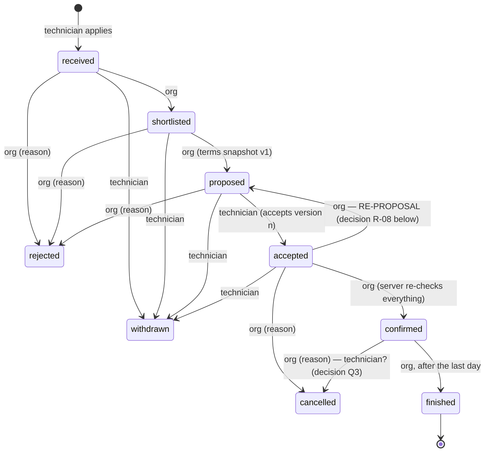

# Applications — state contract (D-06) · DRAFT FOR OWNER REVIEW

> Status: **PROPOSAL, not implemented.** Owner direction of 2026-10-19 (D-06): a server-controlled,
> transactional, authorised and audited state machine; the contract and every transition that creates
> a real commitment between organization and technician are reviewed by the owner **before** any code.
> Sources: V1.8 `server/app.mjs` `application.transition` (lines 112–125), V1.3 demo, conflict R-08
> (`docs/integration/crewflex-v13/03-business-rule-conflicts.md`). Depends on D-07 for what the
> organization may see (`CANDIDATE_PACK.md` §design).

## 1. States

| State         | Meaning (product)                                                                          | V1.8 name / ES label          |
| ------------- | ------------------------------------------------------------------------------------------ | ----------------------------- |
| `received`    | The technician applied to an open requirement with a chosen set of days                    | received · Recibida           |
| `shortlisted` | The organization is reviewing it seriously (preselection)                                  | shortlisted · Preseleccionada |
| `proposed`    | The organization sent a proposal: an immutable snapshot of the terms the requirement shows | proposed · Propuesta          |
| `accepted`    | The technician accepted **that** proposal version                                          | accepted · Aceptada           |
| `confirmed`   | The organization confirmed after the server re-checked eligibility → an **assignment**     | confirmed · Confirmada        |
| `finished`    | The assignment ended (closure)                                                             | finished · Finalizada         |
| `rejected`    | Closed by the organization before confirmation (reason required)                           | rejected · Rechazada          |
| `withdrawn`   | Closed by the technician before confirmation                                               | withdrawn · Retirada          |
| `cancelled`   | An accepted or confirmed engagement was called off (reason required)                       | cancelled · Cancelada         |

Terminal: `finished`, `rejected`, `withdrawn`, `cancelled`. No state is ever deleted; history is kept.

## 2. Transitions

| From → to                      | Actor (from the JWT, never the body)       | Server preconditions                                                                                                                                                                                                                                                                                                                                                                                   | Writes (one transaction)                                                                 | Audit event               |
| ------------------------------ | ------------------------------------------ | ------------------------------------------------------------------------------------------------------------------------------------------------------------------------------------------------------------------------------------------------------------------------------------------------------------------------------------------------------------------------------------------------------ | ---------------------------------------------------------------------------------------- | ------------------------- |
| ∅ → received                   | technician (own profile)                   | requirement `open`, days in the future, not already applied (unique per requirement + technician), D-07 consents as chosen                                                                                                                                                                                                                                                                             | application row, chosen days                                                             | `application.received`    |
| received → shortlisted         | org admin/manager of the requirement's org | requirement still `open`                                                                                                                                                                                                                                                                                                                                                                               | status                                                                                   | `application.shortlisted` |
| shortlisted → proposed         | org admin/manager                          | requirement `open`; days still future                                                                                                                                                                                                                                                                                                                                                                  | **proposal version n**: frozen copy of title, base, period, days, shift, published terms | `application.proposed`    |
| proposed → accepted            | technician                                 | explicit `acceptTerms = true` **and** the proposal version id the technician saw (stale version → 409)                                                                                                                                                                                                                                                                                                 | `accepted_version`, `accepted_at`                                                        | `application.accepted`    |
| accepted → confirmed           | org admin/manager                          | **all re-checked at commit:** requirement open and not started; every hard qualification active + verified + valid (BR-2/3, OD-3: pending never counts); availability covers 100 % with BR-4.8 for the requirement's urgency; no overlapping confirmed assignment of the technician; confirmed count < headcount (row lock on the requirement); D-07 document conditions if the requirement needs them | status, `assignment` (derived), requirement → `covered` when headcount reached           | `application.confirmed`   |
| confirmed → finished           | org admin/manager                          | last day has ended                                                                                                                                                                                                                                                                                                                                                                                     | status                                                                                   | `application.finished`    |
| * → rejected                   | org admin/manager                          | from received/shortlisted/proposed (and accepted, see R-08); reason 1–1000 chars                                                                                                                                                                                                                                                                                                                       | status, reason                                                                           | `application.rejected`    |
| * → withdrawn                  | technician                                 | before `confirmed`                                                                                                                                                                                                                                                                                                                                                                                     | status; D-07 access ends for the future                                                  | `application.withdrawn`   |
| accepted/confirmed → cancelled | org admin/manager (technician: Q3)         | reason 1–1000 chars                                                                                                                                                                                                                                                                                                                                                                                    | status, reason; assignment released                                                      | `application.cancelled`   |

Every transition: one SQL function (`SECURITY INVOKER` where RLS suffices), `Idempotency-Key`
(replay returns the same result), optimistic version check (`updated_at`), `SELECT … FOR UPDATE` on the
application and, for confirmation, on the requirement (headcount race, like E-3/review race checks).
Invalid transition → 409; wrong actor → 403/404 without revealing existence; audit row in the same
transaction. Business logic in `src/domain/applications.ts` (pure table of allowed transitions, shared
with the Edge Function and mirrored by the SQL function, with a parity test as in suite M/P).

## 3. What a transition does NOT do

- **No contractual effect is invented.** Crew Flex records an intention and its terms snapshot; the
  employment or service contract is agreed directly between the parties (V1.8 notice text). Acceptance
  is not a signature; confirmation is not an employment contract.
- **No automatic notifications** (e-mail, SMS, push, WhatsApp are OUT). The other party sees the new
  state in the app. An in-app notification centre is a separate, later decision.
- **No money:** no commission, fee or invoice (OD-7, OUT). The prototype's fee fields are not ported.
- **No identity or document unlock by itself**: governed only by D-07 consents.

## 4. Decisions needed from the owner

| #    | Question                                                                                | Options                                                                                                        | Recommendation                                                                                                                                                           |
| ---- | --------------------------------------------------------------------------------------- | -------------------------------------------------------------------------------------------------------------- | ------------------------------------------------------------------------------------------------------------------------------------------------------------------------ |
| R-08 | **Re-proposal after acceptance** (V1.3 demo allowed it; V1.8 server did not)            | (a) forbid: org must cancel and the technician re-applies · (b) allow `accepted → proposed` with a new version | **(b)**, only before `confirmed`: version n+1 voids the acceptance of version n (kept in history), the technician must accept again; audited as `application.reproposed` |
| Q2   | May the organization cancel an `accepted` (not yet confirmed) application?              | yes with reason (V1.8) · only reject                                                                           | Yes with reason, audited (it is a commitment-free state)                                                                                                                 |
| Q3   | Who may cancel a **confirmed** assignment?                                              | org only (V1.8) · both parties with reason                                                                     | Both, with a mandatory reason; the technician's cancellation is visible to the org; no penalty logic                                                                     |
| Q4   | Does `finished` need an explicit org action or happen automatically after the last day? | explicit · scheduled job                                                                                       | Explicit org action (no scheduler needed; a pending list after the end date)                                                                                             |
| Q5   | Can a technician apply to the same requirement again after `withdrawn`/`rejected`?      | never · after rejection no, after withdrawal yes                                                               | Only after `withdrawn`, as a new application (history preserved)                                                                                                         |
| Q6   | Partial staffing (several technicians covering different days of one requirement)       | later (C-4, D-08)                                                                                              | Keep one period per application in this block; per-day staffing waits for D-08                                                                                           |

## 5. Not in this block

Assignments calendar for the technician (derived view only), messaging (OUT: chat), ratings (OUT),
commissions (OUT), recruiter on behalf of clients (D-12, later).
